# GEIH Explorer

Explorador interactivo de datos de la Gran Encuesta Integrada de Hogares (GEIH) de Colombia.

[](TU_URL_AQUI)

## 📋 Descripción

Esta aplicación permite explorar los microdatos de la GEIH desde 2007 hasta 2025 de forma interactiva, sin necesidad de descargar archivos grandes o instalar software especializado.

### Características Principales

- 🔍 **Exploración Visual**: Interfaz intuitiva para navegar por años y categorías
- 📊 **Datos Completos**: Acceso a 9 categorías de datos socioeconómicos
- ⚡ **Consultas Rápidas**: Motor analítico DuckDB con datos en Parquet
- 🌐 **Sin Descargas**: Datos almacenados en Cloudflare R2, accesibles desde cualquier lugar
- 🔒 **Seguridad**: Consultas SQL validadas, solo lectura de datos
- 📥 **Exportación**: Descarga de resultados en formato CSV

## 🗂️ Categorías de Datos

| Categoría | Descripción | Cobertura |
|-----------|-------------|-----------|
| **Características** | Demografía, educación, salud | 2007-2025 |
| **Hogar** | Composición y condiciones de vivienda | 2007-2025 |
| **Fuerza de Trabajo** | Población en edad de trabajar | 2007-2025 |
| **Ocupados** | Empleo y características laborales | 2007-2025 |
| **No Ocupados** | Desempleo y búsqueda de trabajo | 2007-2025 |
| **Inactivos** | Personas fuera de la fuerza laboral | 2007-2025 |
| **Migración** | Datos de migración interna e internacional | 2022-2025 |
| **Otras Actividades** | Trabajo no remunerado y voluntario | 2007-2025 |
| **Otros Ingresos** | Ingresos adicionales y transferencias | 2007-2025 |

### Formatos de Datos por Año

- **2007-2021 (excepto 2020)**: Datos divididos en `cabecera` (áreas metropolitanas) y `resto` (otras áreas urbanas)
- **2020 y 2022+**: Datos en formato `total` (unificado)

## 🚀 Despliegue en Streamlit Cloud

### Requisitos Previos

- Cuenta de GitHub
- Cuenta en [Streamlit Cloud](https://share.streamlit.io/)
- Credenciales de Cloudflare R2 (Access Key y Secret Key)

### Paso 1: Preparar el Repositorio

Asegúrate de tener estos archivos en tu repo:

```
geih_streamlit/
├── app.py                      # ✅ Aplicación principal
├── requirements.txt            # ✅ Dependencias
├── README.md                   # ✅ Este archivo
├── .streamlit/
│   ├── config.toml            # ✅ Configuración de Streamlit
│   └── secrets.toml.example   # ✅ Ejemplo de secrets
├── scripts/
│   ├── config.py              # ✅ Configuración R2
│   ├── r2_connector.py        # ✅ Conector a R2
│   └── db_metadata.py         # ✅ Metadatos
└── assets/
    └── OCSA-logo.png          # ✅ Logo institucional
```

### Paso 2: Configurar Secrets

1. Ve a [share.streamlit.io](https://share.streamlit.io/) e inicia sesión
2. Crea una nueva app conectando tu repositorio
3. Ve a **Settings → Secrets** de tu aplicación
4. Agrega las credenciales de R2 en formato TOML:

```toml
[R2]
R2_ENDPOINT_URL = "https://tu-account-id.r2.cloudflarestorage.com"
R2_ACCESS_KEY_ID = "tu_access_key_id"
R2_SECRET_ACCESS_KEY = "tu_secret_access_key"
R2_BUCKET_NAME = "tu-bucket-name"
```

> ⚠️ **IMPORTANTE**: Nunca subas las credenciales directamente al código. Usa siempre el sistema de secrets de Streamlit Cloud.

### Paso 3: Desplegar

1. Selecciona el archivo `app.py` como punto de entrada
2. Haz clic en **Deploy**
3. ¡Listo! Tu app estará disponible en una URL pública

## 🛠️ Desarrollo Local

### Instalación

```bash
# Clonar el repositorio
git clone https://github.com/TU_USUARIO/TU_REPO.git
cd TU_REPO

# Crear entorno virtual (recomendado)
python -m venv venv
source venv/bin/activate  # Linux/Mac
# o
venv\Scripts\activate     # Windows

# Instalar dependencias
pip install -r requirements.txt
```

### Configuración Local

Crea un archivo `.env` en la raíz del proyecto:

```bash
R2_ENDPOINT_URL=https://tu-account-id.r2.cloudflarestorage.com
R2_ACCESS_KEY_ID=tu_access_key_id
R2_SECRET_ACCESS_KEY=tu_secret_access_key
R2_BUCKET_NAME=tu-bucket-name
```

> El archivo `.env` está en `.gitignore` y no se subirá al repositorio.

### Ejecutar Localmente

```bash
streamlit run app.py
```

La aplicación estará disponible en `http://localhost:8501`

## 🏗️ Arquitectura

### Diagrama de Componentes

```
┌─────────────────┐
│   Usuario Web   │
│   (Navegador)   │
└────────┬────────┘
         │
         ▼
┌─────────────────┐
│   Streamlit     │
│   Cloud         │
│   (app.py)      │
└────────┬────────┘
         │
         ▼
┌─────────────────┐
│    DuckDB       │
│   (Embebido)   │
└────────┬────────┘
         │
         ▼
┌─────────────────┐
│  Cloudflare R2  │
│  (Parquet Files) │
└─────────────────┘
```

### Tecnologías Utilizadas

| Tecnología | Propósito |
|------------|-----------|
| **Streamlit** | Framework web para aplicaciones de datos |
| **DuckDB** | Base de datos analítica embebida |
| **Apache Parquet** | Formato de almacenamiento columnar eficiente |
| **Cloudflare R2** | Almacenamiento de objetos en la nube (S3-compatible) |
| **Boto3** | SDK de AWS para Python |
| **Pandas** | Manipulación y análisis de datos |

## 📁 Estructura del Proyecto

```
geih_streamlit/
├── app.py                      # Aplicación Streamlit principal
├── requirements.txt            # Dependencias de Python
├── README.md                   # Documentación principal
├── .streamlit/
│   ├── config.toml            # Configuración de tema y servidor
│   └── secrets.toml.example   # Plantilla de secrets
├── scripts/
│   ├── config.py              # Configuración de credenciales R2
│   ├── r2_connector.py        # Conector a Cloudflare R2
│   ├── db_metadata.py         # Metadatos de categorías
│   ├── build_duckdb.py        # Construcción de base local
│   ├── export_all_to_parquet.py  # Exportación a Parquet
│   ├── upload_parquet_parallel.py # Subida a R2
│   ├── cleanup_and_upload.py  # Limpieza y sincronización
│   ├── verify_r2_upload.py    # Verificación de subida
│   └── read_files.py          # Lectura de archivos fuente
├── assets/
│   └── OCSA-logo.png          # Logo institucional
└── docs/                      # Documentación técnica
    ├── README.md
    ├── architecture.md
    ├── app.md
    ├── config.md
    ├── r2_connector.md
    ├── db_metadata.md
    └── maintenance_scripts.md
```

## 🔧 Mantenimiento de Datos

Para actualizar los datos (ej: agregar año 2026):

```bash
# 1. Actualizar archivos CSV fuente

# 2. Reconstruir base de datos local
python scripts/build_duckdb.py

# 3. Exportar a Parquet
python scripts/export_all_to_parquet.py

# 4. Subir a R2
python scripts/upload_parquet_parallel.py

# 5. Verificar subida
python -m scripts.verify_r2_upload
```

Ver [docs/maintenance_scripts.md](docs/maintenance_scripts.md) para más detalles.

## 🔒 Seguridad

- Las credenciales de R2 se almacenan en **Streamlit Secrets** (encriptado)
- Las consultas SQL tienen validación básica (bloquea DROP, ALTER, DELETE, etc.)
- Se recomienda configurar el bucket R2 como **solo lectura** para la app
- No se almacenan datos de usuario ni consultas

## 🐛 Solución de Problemas

### Error: "No module named 'scripts'"

Ejecuta desde la raíz del proyecto:
```bash
python -m streamlit run app.py
```

### Error: "Faltan variables de entorno"

Verifica que hayas configurado los secrets en Streamlit Cloud o el archivo `.env` local.

### Error: "No se encontraron datos"

Verifica que los archivos Parquet estén correctamente subidos a R2:
```bash
python -m scripts.verify_r2_upload
```

## 📚 Documentación Adicional

- [Arquitectura del Sistema](docs/architecture.md)
- [Guía de Desarrollo](docs/)
- [Referencia de API](docs/)

## 👨‍💻 Desarrollo

Desarrollado por **Juan Camilo Pinedo**

**Observatorio de Condiciones Socioeconómicas (OCSA)**
Universidad del Norte, Barranquilla, Colombia

## 📊 Fuente de Datos

Datos proporcionados por el **DANE** (Departamento Administrativo Nacional de Estadística) de Colombia.

- [Sitio web del DANE](https://www.dane.gov.co/)
- [Microdatos GEIH](https://www.dane.gov.co/index.php/estadisticas-por-tema/mercado-laboral/encuesta-geih)

## 📄 Licencia

MIT License - ver archivo [LICENSE](LICENSE) para detalles.

## 🤝 Contribuciones

Las contribuciones son bienvenidas. Por favor, abre un issue o pull request para discutir cambios importantes.

## 📧 Contacto

Para preguntas o soporte, contacta al Observatorio de Condiciones Socioeconómicas (OCSA) de la Universidad del Norte.

---

<p align="center">
  
  <br>
  <em>Observatorio de Condiciones Socioeconómicas (OCSA)</em>
  <br>
  <em>Universidad del Norte</em>
</p>
